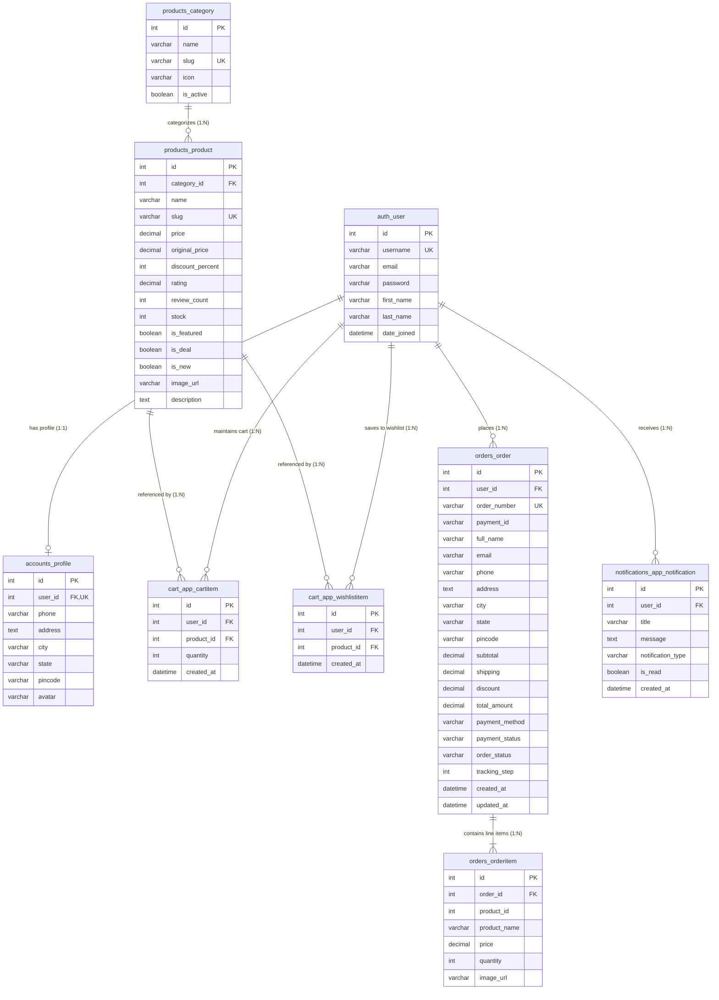

# NovaCart — Database Architecture Documentation

## Overview

The **NovaCart** database layer is designed as an ACID-compliant relational data store powered by **SQLite 3** through Django's Object-Relational Mapping (ORM) engine. The schema maintains data integrity, historical price immutability, per-user ownership isolation, and relational cascading.

All pricing columns (`price`, `subtotal`, `shipping`, `discount`, `total_amount`) use high-precision decimals standardized to **Indian Rupees (`₹`)**.

---

## Directory Structure (`database/`)

```text
database/
│
├── db.sqlite3                  # Active SQLite relational database binary
├── schema.sql                  # Full SQL DDL definition (CREATE TABLE, INDEX, CONSTRAINTS)
└── seed_db.py                  # Database seeding script (categories, products, demo users)
```

---

## Entity-Relationship (ER) Diagram



---

## Detailed Table Specifications

### 1. `orders_order` (Customer Orders)
| Column | Type | Constraints | Description |
|---|---|---|---|
| `id` | `INTEGER` | Primary Key, Auto-increment | Unique internal order identifier |
| `user_id` | `INTEGER` | Foreign Key (`auth_user.id`) | Customer who placed the order |
| `order_number` | `VARCHAR(32)` | Unique, Not Null | Formatted order code (e.g. `ORD-20261010-8271`) |
| `payment_id` | `VARCHAR(64)` | Nullable | Idempotency transaction key |
| `full_name` | `VARCHAR(100)`| Not Null | Customer's delivery name |
| `email` | `VARCHAR(254)`| Not Null | Customer's contact email |
| `phone` | `VARCHAR(20)` | Not Null | Customer's contact phone number |
| `address` | `TEXT` | Not Null | Full delivery street address |
| `city` | `VARCHAR(100)`| Not Null | Delivery city |
| `state` | `VARCHAR(100)`| Not Null | Delivery state / province |
| `pincode` | `VARCHAR(20)` | Not Null | Delivery postal code |
| `subtotal` | `DECIMAL(10,2)`| Not Null | Sum of items price in `₹` |
| `shipping` | `DECIMAL(10,2)`| Not Null | Shipping charge in `₹` |
| `discount` | `DECIMAL(10,2)`| Default `0.00` | Applied promo discount in `₹` |
| `total_amount` | `DECIMAL(10,2)`| Not Null | Final charged amount in `₹` |
| `payment_method` | `VARCHAR(50)` | Not Null | `card`, `upi`, `netbanking`, `cod` |
| `payment_status` | `VARCHAR(20)` | Default `'completed'` | Payment status (`completed`, `pending`, `failed`) |
| `order_status` | `VARCHAR(20)` | Default `'processing'`| `processing`, `shipped`, `delivered`, `cancelled` |
| `tracking_step` | `INTEGER` | Default `1` | Timeline milestone (`1`=Placed, `2`=Processing, `3`=Shipped, `4`=Delivered) |
| `created_at` | `DATETIME` | Not Null | Order placement timestamp |

### 2. `orders_orderitem` (Line-Item Price Snapshots)
| Column | Type | Constraints | Description |
|---|---|---|---|
| `id` | `INTEGER` | Primary Key, Auto-increment | Line item identifier |
| `order_id` | `INTEGER` | Foreign Key (`orders_order.id`, Cascade) | Associated parent order |
| `product_id` | `INTEGER` | Nullable | Referenced catalog product ID |
| `product_name` | `VARCHAR(255)`| Not Null | Snapshot of product title at time of order |
| `price` | `DECIMAL(10,2)`| Not Null | **Immutable snapshot** of item price in `₹` |
| `quantity` | `INTEGER` | Not Null | Quantity purchased |
| `image_url` | `VARCHAR(500)`| Nullable | Snapshot of thumbnail image URL |

> **Design Decision — Snapshot Immutability:** Storing `product_name` and `price` directly in `orders_orderitem` guarantees that historical invoices never change even if products are later renamed, re-priced, or deleted from the catalog.

---

## Seeding & Database Initialization

The database comes pre-seeded with catalog categories, products, notifications, and demo customer accounts.

To re-seed or reset the database at any time:
```bash
# 1. Apply schema migrations
python manage.py migrate

# 2. Populate demo catalog & users
python database/seed_db.py
```

### Pre-Seeded Demo Customer
* **Username:** `priya_sharma`
* **Email:** `priya.sharma@example.com`
* **Password:** `NovaCart@2026`
* **Pre-populated Address:** Flat 402, Lotus Residency, MG Road, Bengaluru, Karnataka, 560001

---

## SQL DDL Export (`database/schema.sql`)

The complete raw SQL definition with all table schemas, primary keys, foreign key constraints, and SQLite indexes is exported and kept up-to-date in:
[database/schema.sql](file:///d:/Internship/Full%20Stack%20Projects/NoveShoppingCart/database/schema.sql)
