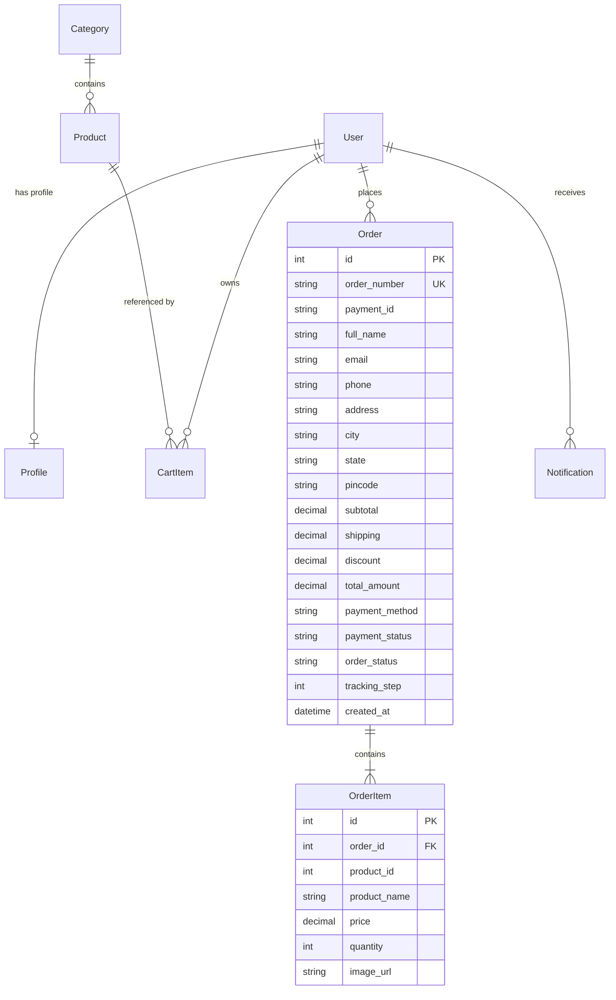

# NovaCart — Modern Full-Stack E-Commerce Platform

[](https://www.python.org/)
[](https://www.djangoproject.com/)
[](https://www.sqlite.org/)
[](https://developer.mozilla.org/)
[-5145E5?style=flat)](https://en.wikipedia.org/wiki/Indian_rupee)

NovaCart is a full-featured, responsive e-commerce web application engineered with a clean **Django backend architecture** and a modern, high-performance **Vanilla JavaScript & CSS frontend design system**. It features real-time catalog management, persistent carts, payment processing, live order tracking, and strict per-user order isolation — all formatted natively in Indian Rupees (`₹`).

---

## Table of Contents

- [Overview & Architecture](#overview--architecture)
- [Key Features](#key-features)
- [Storefront Interfaces](#storefront-interfaces)
- [Technology Stack](#technology-stack)
- [Project Directory Structure](#project-directory-structure)
- [Database Schema & Models](#database-schema--models)
- [REST API Reference](#rest-api-reference)
- [Installation & Local Setup](#installation--local-setup)
- [Demo Credentials](#demo-credentials)
- [Testing & Quality Assurance](#testing--quality-assurance)
- [License & Credits](#license--credits)

---

## Overview & Architecture

NovaCart is designed around separation of concerns:

1. **Backend Core (Django 6.1.1 + SQLite):**
   * Robust relational database management with atomic operations for cart clearing and order creation.
   * Session-based authentication with cookie persistence and CSRF protection.
   * Multi-app modular design (`accounts`, `products`, `cart_app`, `orders`, `notifications_app`).
   * Strict user isolation: users can only view, track, and manage their own orders (`check_order_ownership`).

2. **Frontend Architecture (Vanilla ES6+ & CSS3 Design System):**
   * Zero heavy external frontend frameworks — fast initial page load.
   * Centralized `NovaAPI` client (`js/api-client.js`) managing network requests, badges, and auth states.
   * Curated design tokens (`--nc-primary: #5145E5;`, `--nc-bg: #F7F8FC;`, `Inter` font) for sleek typography, smooth micro-animations, and fluid responsive grid layouts.
   * Real-time client-side synchronization for cart counts, wishlist toggles, and toast alerts.

---

## Key Features

* **Currency Standardization:** Indian Rupee (`₹`) formatted across all products, cart summaries, checkout receipts, and order histories.
* **Easy Order Access:**
  * One-click **My Orders** header shortcut (custom package SVG icon), desktop primary nav link, and mobile navigation drawer link.
  * Compact **Your Recent Orders** section on the Home Page showing the latest 3 orders with order numbers, dates, thumbnails, prices, and status badges.
  * Direct deep links to order details and shipment tracking.
* **Interactive Live Search:** Real-time dropdown search with product thumbnails and prices; pressing <kbd>Enter</kbd> routes to filtered search results.
* **Dynamic Shop & Filtering:** Multi-criteria filtering by category, price slider, in-stock availability, star ratings, and sorting (Featured, Price Low-High, Price High-Low, Newest).
* **Slide-in Cart Drawer:** Persistent drawer accessible from any page with real-time quantity updates, item removal, and subtotal calculations.
* **Checkout & Payment:** Multi-step checkout with address validation and simulated payment processing (Cards, UPI, Net Banking, COD) backed by idempotency tokens (`payment_id`) to prevent duplicate submissions.
* **Order Tracking & Invoice Details:**
  * 4-stage visual timeline: **Order Placed** → **Processing** → **Shipped** → **Delivered**.
  * Printable invoice/receipt view.
  * Immutable line-item snapshots protecting historical receipts against future price changes.
* **In-App Notifications:** Real-time notification center for order placements, promotions, and status updates with read/unread tracking.

---

## Storefront Interfaces

| # | Page / Interface | File | Description |
|---|---|---|---|
| 1 | **Home Page** | `index.html` | Hero showcase, category cards, featured products, flash sale with live countdown, new arrivals tabs, promo banner, customer reviews, newsletter, and dynamic recent orders. |
| 2 | **Shop Catalog** | `shop.html` | Full product catalog with multi-facet filters, search query parameters, sort controls, and pagination. |
| 3 | **Product Details** | `product.html` | Gallery preview, stock status, ratings, quantity selector, add-to-cart, wishlist toggle, specifications, and customer reviews. |
| 4 | **Shopping Cart** | `cart.html` | Full-page cart table with item quantities, price calculations, coupon input, and checkout summary. |
| 5 | **Empty Cart State** | `empty-cart.html` | Friendly empty cart illustration with recommendations and "Start Shopping" button. |
| 6 | **Checkout** | `checkout.html` | Shipping and billing address forms, contact details, delivery method selection, and order breakdown. |
| 7 | **Payment** | `payment.html` | Secure payment simulator with Card, UPI, Net Banking, and Cash on Delivery options. |
| 8 | **Order Success** | `order-success.html` | Order confirmation screen with unique Order ID, transaction details, and quick shortcuts. |
| 9 | **My Orders** | `orders.html` | Comprehensive order history dashboard with status badges, order dates, and actions. |
| 10 | **Order Details** | `order-details.html` | Complete order breakdown, line items snapshot, shipping destination, payment status, and printable invoice. |
| 11 | **Order Tracking** | `order-tracking.html` | Visual 4-step progress tracker with live courier details and estimated delivery date. |
| 12 | **Wishlist** | `wishlist.html` | Saved items dashboard with instant "Move to Cart" and item removal actions. |
| 13 | **Login** | `login.html` | User authentication with real-time inline validation and session persistence. |
| 14 | **Registration** | `register.html` | User sign-up with password strength requirements and terms validation. |
| 15 | **User Profile** | `profile.html` | Personal profile dashboard for updating contact information and default shipping addresses. |
| 16 | **Notifications** | `notifications.html` | Notification center with mark-all-as-read and clear actions. |
| 17 | **Mobile Drawer / Menu** | `mobile-menu.html` | Optimized mobile touch navigation drawer with badge indicators. |
| 18 | **404 Not Found** | `404.html` | Branded 404 error page with search bar and navigation recovery buttons. |

---

## Technology Stack

### Backend
* **Language:** Python 3.12+
* **Framework:** Django 6.1.1
* **Database:** SQLite 3 (ORM with migrations)
* **Architecture:** Model-View-Controller (MVC) / Django MVT + REST APIs
* **Security:** Django Auth, Session Cookies, CSRF verification, Ownership validation

### Frontend
* **Markup:** Semantic HTML5
* **Styles:** Custom CSS3 with Design Tokens (variables, flexbox, CSS grid, micro-transitions)
* **Typography:** Inter (via Google Fonts)
* **Logic:** Vanilla JavaScript (ES6+ modular, zero external JS libraries)
* **Icons:** Inline optimized SVG vector icons (Feather / Lucide design)

---

## Project Directory Structure

```text
NoveShoppingCart/
│
├── manage.py                     # Django management script
├── seed_db.py                    # Database seeding script (categories, products, demo users)
├── requirements.txt              # Python package dependencies
├── db.sqlite3                    # SQLite relational database
│
├── novacart_project/             # Django project configuration
│   ├── __init__.py
│   ├── settings.py               # Global Django configuration & app registry
│   ├── urls.py                   # Master routing (APIs + static page delivery)
│   ├── views.py                  # Page serving views
│   └── wsgi.py                   # WSGI entry point
│
├── accounts/                     # User accounts & profiles app
│   ├── models.py                 # Profile model (phone, address, avatar)
│   └── views.py                  # Register, Login, Logout, Profile APIs
│
├── products/                     # Product catalog app
│   ├── models.py                 # Category & Product models
│   └── views.py                  # Products list, detail, and categories APIs
│
├── cart_app/                     # Shopping cart & wishlist app
│   ├── models.py                 # CartItem & WishlistItem models
│   └── views.py                  # Cart CRUD & Wishlist toggle APIs
│
├── orders/                       # Order processing & tracking app
│   ├── models.py                 # Order & OrderItem models (snapshots, idempotency)
│   └── views.py                  # Order creation, order list, ownership checks, tracking APIs
│
├── notifications_app/            # Notifications app
│   ├── models.py                 # Notification model
│   └── views.py                  # Notification list and mark-as-read APIs
│
├── css/                          # Stylesheets
│   ├── style.css                 # Global design system & home page styles
│   ├── orders.css                # Orders, Order Details, Tracking & Recent Orders styling
│   ├── shop.css                  # Shop catalog and filter styling
│   ├── product.css               # Product detail view styling
│   ├── cart.css                  # Cart and checkout flow styling
│   └── notifications.css         # Notification center styling
│
├── js/                           # JavaScript modules
│   ├── api-client.js             # Centralized NovaAPI service & global badge sync
│   ├── script.js                 # Home page dynamic logic & recent orders loader
│   ├── orders.js                 # My Orders page logic
│   ├── order-details.js          # Order Details & invoice generator logic
│   ├── order-tracking.js         # Order Tracking live timeline logic
│   ├── shop.js                   # Shop catalog, multi-facet filtering & sorting
│   ├── product.js                # Product detail interactions
│   ├── cart.js                   # Cart calculations and side drawer
│   ├── payment.js                # Payment simulation & order creation trigger
│   └── login.js / register.js    # Authentication and inline validation
│
├── assets/                       # Static media assets
│   ├── icons/                    # SVG vector icons
│   ├── products/                 # Product SVG/image assets
│   ├── categories/               # Category icon assets
│   └── avatars/                  # User avatar illustrations
│
├── index.html                    # Home Page
├── shop.html                     # Shop Page
├── product.html                  # Product Detail Page
├── cart.html                     # Cart Page
├── empty-cart.html               # Empty Cart Page
├── checkout.html                 # Checkout Page
├── payment.html                  # Payment Page
├── order-success.html            # Order Success Page
├── orders.html                   # My Orders Page
├── order-details.html            # Order Details Page
├── order-tracking.html           # Order Tracking Page
├── wishlist.html                 # Wishlist Page
├── profile.html                  # Profile Page
├── login.html                    # Login Page
├── register.html                 # Registration Page
├── notifications.html            # Notifications Page
└── 404.html                      # 404 Page
```

---

## Database Schema & Models



* **Historical Price Snapshot:** When an order is placed, purchased products are cloned into `OrderItem` with the exact purchase price and name at that moment. Future updates to the product catalog never modify past orders.
* **Payment Idempotency:** Orders store a unique `payment_id`. Repeated payment confirmations reuse the existing order, preventing double charging and duplicate order generation.

---

## REST API Reference

### Authentication & Account
| Method | Endpoint | Description |
|---|---|---|
| `POST` | `/api/auth/register/` | Register a new user account |
| `POST` | `/api/auth/login/` | Authenticate user and initiate session |
| `POST` | `/api/auth/logout/` | End user session |
| `GET` | `/api/auth/profile/` | Fetch current user profile (`?strict=true` returns 401 if unauthenticated) |
| `POST` | `/api/auth/profile/` | Update user profile and shipping details |

### Products & Catalog
| Method | Endpoint | Description |
|---|---|---|
| `GET` | `/api/products/` | List products with query params (`?search=`, `?category=`, `?deals=`, `?sort=`) |
| `GET` | `/api/products/<identifier>/` | Get detailed product information by ID or slug |
| `GET` | `/api/categories/` | List all active product categories |

### Cart & Wishlist
| Method | Endpoint | Description |
|---|---|---|
| `GET` | `/api/cart/` | Fetch active user/session shopping cart |
| `POST` | `/api/cart/add/` | Add an item to cart (`product_id`, `quantity`) |
| `POST` | `/api/cart/update/` | Update quantity of a cart item |
| `POST` | `/api/cart/remove/` | Remove item from cart |
| `POST` | `/api/cart/clear/` | Empty the shopping cart |
| `GET` | `/api/wishlist/` | Fetch user wishlist |
| `POST` | `/api/wishlist/toggle/` | Toggle product in/out of wishlist |

### Orders & Tracking
| Method | Endpoint | Description |
|---|---|---|
| `GET` | `/api/orders/` | List authenticated user's orders (returns `authenticated` status + orders list) |
| `POST` | `/api/orders/create/` | Create order, save snapshot items, and clear cart |
| `GET` | `/api/orders/<order_number>/` | Get single order details with ownership verification |
| `GET` | `/api/orders/latest/` | Get user's most recent order |
| `GET` | `/account/orders/` | Browser route or JSON endpoint for user order history |
| `GET` | `/orders/<order_id>/track/` | Browser route or JSON endpoint for shipment tracking |

### Notifications
| Method | Endpoint | Description |
|---|---|---|
| `GET` | `/api/notifications/` | List user in-app notifications |
| `POST` | `/api/notifications/<id>/read/` | Mark single notification as read |
| `POST` | `/api/notifications/read-all/` | Mark all notifications as read |
| `POST` | `/api/notifications/clear/` | Delete all notifications |

---

## Installation & Local Setup

### Prerequisites
* **Python:** 3.10, 3.11, or 3.12 installed on your machine
* **pip:** Python package manager

### 1. Clone or Open Project
```bash
cd "d:/Internship/Full Stack Projects/NoveShoppingCart"
```

### 2. Create and Activate Virtual Environment
```bash
# Windows (PowerShell)
python -m venv venv
.\venv\Scripts\Activate.ps1

# Linux / macOS
python3 -m venv venv
source venv/bin/activate
```

### 3. Install Dependencies
```bash
pip install -r requirements.txt
```

### 4. Run Database Migrations
```bash
python manage.py migrate
```

### 5. Seed Initial Catalog & Demo Data
Populate the database with categories, products in Indian Rupees (`₹`), default notifications, and demo accounts:
```bash
python seed_db.py
```

### 6. Start Development Server
```bash
python manage.py runserver 127.0.0.1:8000
```

Open your browser and navigate to:
```
http://127.0.0.1:8000/
```

---

## Demo Credentials

You can test user flows using the pre-seeded account or register a new user:

| Role | Username / Email | Password |
|---|---|---|
| **Demo Customer** | `priya_sharma` or `priya.sharma@example.com` | `NovaCart@2026` |
| **New Customer** | Self-register via [register.html](http://127.0.0.1:8000/register.html) | Any password with 8+ chars, upper, lower, number |

---

## Testing & Quality Assurance

### End-to-End Shopping Flow Verification
To verify the complete shopping and order cycle:
1. Navigate to **Home Page** (`http://127.0.0.1:8000/`).
2. Log in using `priya_sharma` / `NovaCart@2026`.
3. Add a product (e.g., Wireless Noise-Cancelling Headphones) to cart.
4. Open the Cart Drawer or navigate to Checkout (`checkout.html`).
5. Confirm shipping address and proceed to Payment (`payment.html`).
6. Select any payment method (Card / UPI / Net Banking / COD) and submit.
7. Verify redirect to Order Success (`order-success.html`) and Order Details (`order-details.html`).
8. Return to the Home Page: verify the newly placed order displays under **Your Recent Orders**.
9. Click **View Details** or **Track Order** to review order line items and live shipment milestones.

---

## License & Credits

* **Author:** NovaCart Development Team
* **Framework:** Django Software Foundation
* **Icons:** Feather Icons / Lucide SVG Design
* **Typography:** Inter by Rasmus Andersson (Google Fonts)

*NovaCart — Everything You Need. All in One Place.*
